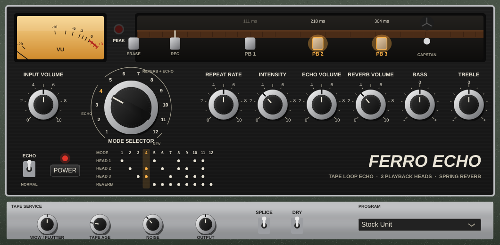

# Ferro Echo v0.1: what it models

## Front panel (as on the hardware)

| Control | Behaviour |
|---|---|
| Input Volume | 0 to 10, unity at 5, +20 dB at 10. Drives a discrete-transistor-style preamp (asymmetric soft clip, so it adds even harmonics before it crunches). The dry signal also passes through this preamp, as on the unit. Peak lamp lights at about -1.5 dBFS after the preamp. |
| VU meter | Record level (input + feedback) going onto the tape, with needle ballistics. |
| Mode Selector | 12 positions. 1: head 1. 2: head 2. 3: head 3. 4: heads 2+3. 5 to 7: single head + reverb. 8: heads 1+2 + reverb. 9: heads 2+3 + reverb. 10: heads 1+3 + reverb. 11: all heads + reverb. 12: reverb only. The head chart is printed under the knob and lights the current column. |
| Repeat Rate | Motor speed. Head delays range 69 to 177 ms (head 1), 131 to 337 ms (head 2), 189 to 489 ms (head 3). The motor has inertia (about 0.3 s to settle), and turning it bends the pitch of the repeats already on the tape. |
| Intensity | Feedback. Repeats die away below about 7; self-oscillation starts around 7.2 and is held in check by tape saturation. With more heads selected the loop takes off a little earlier, as on the hardware. |
| Echo Volume | Level of the echo return. |
| Reverb Volume | Level of the spring tank. No effect in modes 1 to 4. |
| Bass / Treble | Cut/boost shelves (about +-12 dB at 110 Hz / 3 kHz), echo path only, and inside the feedback loop so a treble cut makes each repeat darker than the last. Flat at 12 o'clock. |
| Echo / Normal | The dub switch: stops feeding the tape, while the repeats already on it carry on. |
| Power | Power cycle: erases the tape and the springs (stops a runaway). |

## Tape transport model

- The tape is modelled physically. Every sample is written with the tape position it was written at, and each playback head reads the audio found at (position now - head distance). Speed changes, wow, flutter and splice bumps are all modulations of the same transport, so pitch bending is exact rather than a delay-time approximation.
- Record path: pre-emphasis, tape saturation. Playback path: de-emphasis, head gap / spacing loss whose cutoff follows the tape speed (slow settings sound duller, as on the unit), a head bump that also moves with speed, low cut, tape hiss.
- Wow (slow random drift), flutter (capstan and pinch-roller rotation, whose rates follow the motor speed) and scrape flutter.
- The loop has a fixed set of worn spots, so dropouts come round again every lap. Tape Age adds spots, deepens them, adds HF loss, hiss and wow/flutter. The splice gives a dropout and a tiny click as it passes each head, and a speed hiccup at the capstan.

## Spring reverb

Three springs of different length, each a feedback loop with a chain of stretched allpasses for the dispersive "chirp/drip", band-limited by drive and pickup transducers (about 120 Hz to 4.5 kHz), 2.6 s decay. It is fed by the preamp signal plus the echoes.

## Service strip (not on the hardware)

Wow/Flutter (5 = a healthy unit), Tape Age, Noise, Output (+-20 dB), Splice on/off, Dry on/off (off for use on a send), and the program list.

## Presets

Stock Unit, Slapback Head 1, Gallop (Heads 2+3), Dub Plate, Runaway Oscillation, Spring Tank Only, Cavern (All Heads), Worn Loop, Hot Preamp Crunch, Long Head 3 Wash.

## Assumptions to check against a real unit

- The reverb is fed by the input plus the echoes (echoes are reverberated).
- The tone controls sit inside the feedback loop.
- The exact preamp curve, tone-control frequencies and spring tank decay are educated estimates; a capture of a real unit would let us match them.
- Mono in, mono out (stereo inputs are summed), as on the hardware.

## Not yet done

Tempo sync, oversampling of the saturation stages, a stereo/ping-pong option, installers.
